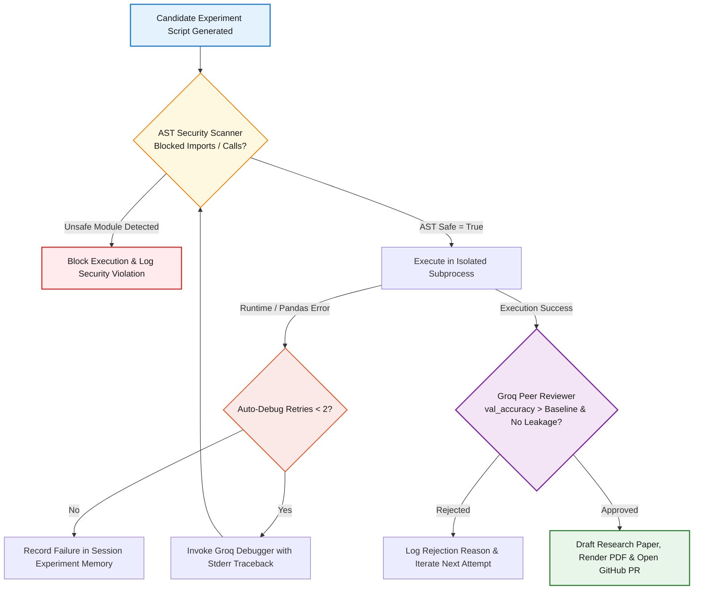

# 🔬 Autonomous AI Scientist Lab
### Automated Hypothesis Generation, Sandboxed Execution & Research Publishing Framework

This repository serves as a self-contained autonomous machine learning research engine for quantitative financial forecasting, regime-aware feature discovery, and closed-loop scientific publishing.

The architecture is explicitly optimized to ingest historical market OHLCV data via Yahoo Finance (`yfinance`), compute information-theoretic regime features (including rolling **Shannon Entropy**), generate structured hypotheses via a **Groq LLM multi-agent pipeline**, validate candidate models inside an **Abstract Syntax Tree (AST) security sandbox** with self-healing debugging, and automatically open **GitHub Pull Requests** alongside downloadable **PDF/Markdown research papers** and live multi-horizon price forecasts.

### About

**Autonomous AI Scientist Lab** built with **Streamlit**, **Groq Multi-Agent Pipelines (`openai/gpt-oss-120b`)**, and **AST Sandboxed Execution**. Features **live Yahoo Finance market ingestion**, **rolling Shannon Entropy & technical feature engineering**, **self-healing auto-debugging**, **automated GitHub PR & portfolio publishing**, and **live multi-horizon price range forecasting**.

### ⭐ Show Your Support

If you like the UI design, multi-agent research architecture, or quantitative ML engineering behind **Autonomous AI Scientist Lab**, please consider giving this repository a **Star ⭐** on GitHub! It helps showcase this work and motivates future builds.

---

---

## Architecture Overview

### System Data Flow Architecture
The diagram below illustrates how historical market data and baseline scripts flow through the multi-agent research loop, AST security sandbox, and automated publishing layers:

### Hypothesis Validation & Self-Healing Logic Flow
The Agentic Subsystem validates every candidate script for security, runtime stability, and strict out-of-sample generalization before promoting or publishing changes:

