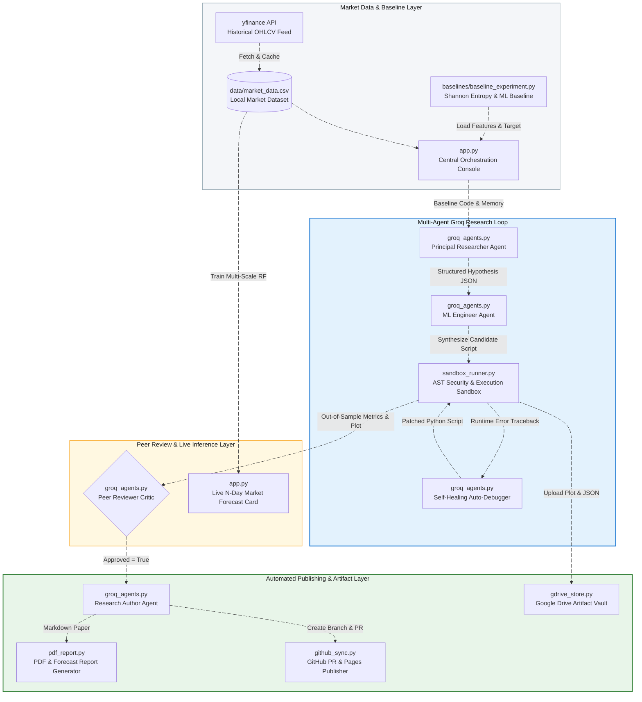
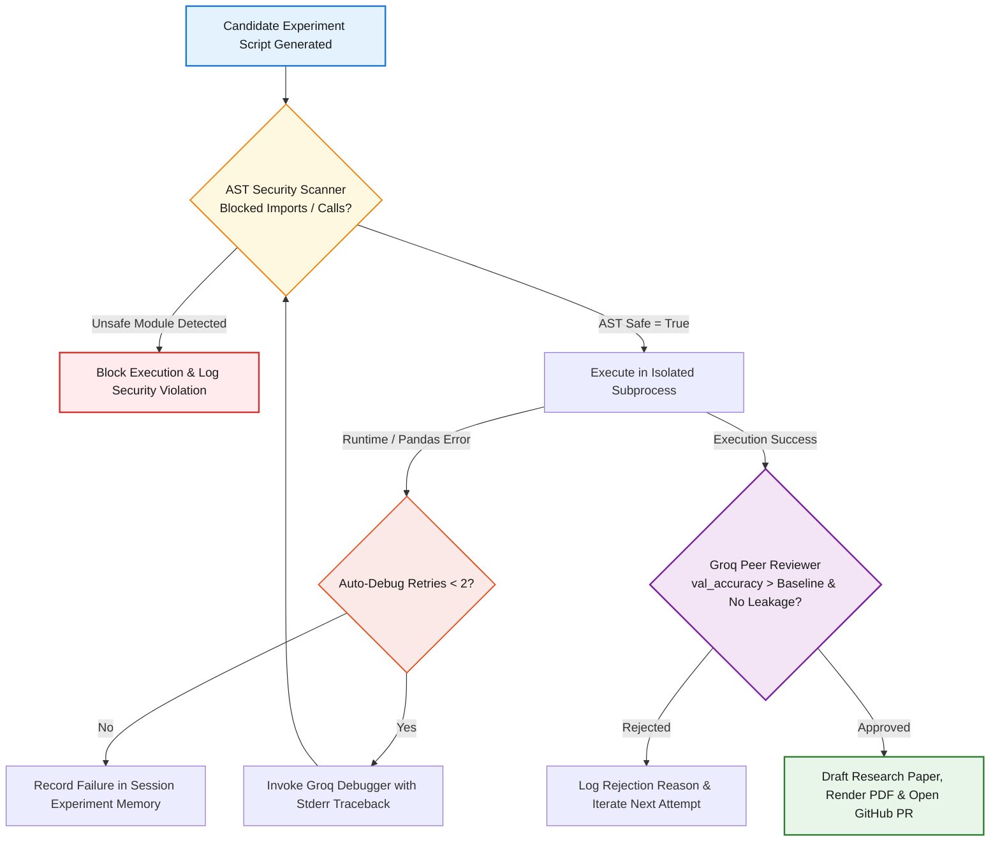

# 🔬 Autonomous AI Scientist Lab
### Automated Hypothesis Generation, Sandboxed Execution & Research Publishing Framework

This repository serves as a self-contained autonomous machine learning research engine for quantitative financial forecasting, regime-aware feature discovery, and closed-loop scientific publishing.

The architecture is explicitly optimized to ingest historical market OHLCV data via Yahoo Finance (`yfinance`), compute information-theoretic regime features (including rolling **Shannon Entropy**), generate structured hypotheses via a **Groq LLM multi-agent pipeline**, validate candidate models inside an **Abstract Syntax Tree (AST) security sandbox** with self-healing debugging, and automatically open **GitHub Pull Requests** alongside downloadable **PDF/Markdown research papers** and live multi-horizon price forecasts.

### About

**Autonomous AI Scientist Lab** built with **Streamlit**, **Groq Multi-Agent Pipelines (`openai/gpt-oss-120b`)**, and **AST Sandboxed Execution**. Features **live Yahoo Finance market ingestion**, **rolling Shannon Entropy & technical feature engineering**, **self-healing auto-debugging**, **automated GitHub PR & portfolio publishing**, and **live multi-horizon price range forecasting**.

### ⭐ Show Your Support

If you like the UI design, multi-agent research architecture, or quantitative ML engineering behind **Autonomous AI Scientist Lab**, please consider giving this repository a **Star ⭐** on GitHub! It helps showcase this work and motivates future builds.

---


---

## Architecture Overview

### System Data Flow Architecture
The diagram below illustrates how historical market data and baseline scripts flow through the multi-agent research loop, AST security sandbox, and automated publishing layers:



### Hypothesis Validation & Self-Healing Logic Flow
The Agentic Subsystem validates every candidate script for security, runtime stability, and strict out-of-sample generalization before promoting or publishing changes:


---

## Repository Tree

```text
ai-scientist-lab/
│
├── .github/
│   └── workflows/
│       ├── run_experiment.yml         # Automated AST security & sandbox CI check on PRs
│       └── publish_to_pages.yml       # Auto-deploys approved reports to srinivasta.github.io
│
├── .streamlit/
│   ├── config.toml                    # Production UI styling & theme configuration
│   └── secrets.toml                   # Local secrets container for Groq, GitHub & Google Drive
│
├── baselines/
│   └── baseline_experiment.py         # Core quantitative ML baseline (Shannon Entropy + RF)
│
├── data/
│   └── market_data.csv                # Cached Yahoo Finance OHLCV historical market dataset
│
├── outputs/
│   ├── candidate_experiment.py        # Latest AI-synthesized candidate ML script
│   ├── metrics.json                   # Out-of-sample evaluation metrics (Accuracy & F1)
│   └── metrics_plot.png               # Diagnostic comparison bar chart
│
├── reports/
│   └── exp-*.md                       # Archived Markdown research papers generated by AI Author
│
├── src/
│   ├── app.py                         # Central Streamlit orchestration console & forecast UI
│   ├── groq_agents.py                 # Multi-agent LLM pipeline (Researcher, Engineer, Debugger, Critic, Author)
│   ├── sandbox_runner.py              # AST static code scanner & isolated subprocess runner
│   ├── pdf_report.py                  # Executive PDF generator with forecast table & embedded plots
│   ├── github_sync.py                 # Automated branch creation, PR opener & Pages publisher
│   └── gdrive_store.py                # Google Drive artifact archival connector
│
├── .gitignore
├── README.md                          # Project architecture & deployment documentation
└── requirements.txt                   # Pinned Python dependencies
```

---

## Core System Architecture Breakdown

### 🤖 Multi-Agent Groq Pipeline (`src/groq_agents.py`)
* **Principal Researcher Agent:** Inspects the baseline script alongside session experiment memory to formulate concrete, non-redundant feature engineering and algorithmic hypotheses.
* **ML Engineer & Self-Healing Debugger:** Synthesizes clean Pandas 2.2+ / Scikit-Learn code to implement proposed hypotheses, and automatically inspects `stderr` tracebacks to patch runtime errors (up to 2 auto-debug retries).
* **Peer Reviewer Critic:** Enforces a strict out-of-sample acceptance gate—approving candidate models only when `val_accuracy` strictly improves without lookahead leakage.
* **Research Author Agent:** Drafts structured, publication-grade Markdown papers with YAML frontmatter grounded strictly in verified experiment hyperparameters and metrics.

### 🛡️ AST Security Sandbox (`src/sandbox_runner.py`)
* **Static AST Inspection:** Parses every AI-generated script into an Abstract Syntax Tree before execution, blocking unauthorized imports (`os.system`, `subprocess`, `socket`, `requests`, `urllib`) and unsafe built-ins (`eval`, `exec`).
* **Isolated Process Execution:** Runs validated experiments in a subprocess with strict execution timeouts and standardized JSON/PNG artifact collection.

### 📈 Quantitative Baseline & Live Forecast Engine (`baselines/baseline_experiment.py` & `src/app.py`)
* **Information-Theoretic Regime Features:** Computes 20-day rolling **Shannon Entropy** over binned log returns alongside multi-horizon momentum (`ret_1d`, `ret_5d`, `ret_20d`), volatility (`vol_10d`), SMA ratios, and high-low spreads.
* **Strict Chronological Validation:** Uses an 80/20 time-ordered train/validation split to eliminate forward-looking bias.
* **Multi-Horizon Live Inference:** Trains a multi-scale Random Forest model on fetched Yahoo Finance (`yfinance`) tickers (`^NSEI`, `RELIANCE.NS`, `SPY`) to project directional confidence and $\pm 1\sigma$ price ranges across **1, 5, 10, and 20 trading days**.

### 📑 Automated Publishing & Archival (`src/pdf_report.py`, `src/github_sync.py`, `src/gdrive_store.py`)
* **PDF & Markdown Reporting:** Exports publication-ready `.pdf` reports (complete with bordered results tables, live forecast summaries, and embedded charts) alongside `.md` and `.py` downloads.
* **GitOps CI/CD Integration:** Automatically creates feature branches, opens GitHub Pull Requests for winning experiments, and publishes approved reports directly to **`srinivasta.github.io`**.

---

## Getting Started: Local Deployment Lifecycle

Follow these terminal commands to install dependencies, configure secrets, and launch the Autonomous AI Scientist Lab locally:

```bash
# 1. Clone the repository
git clone https://github.com
cd ai-scientist-lab

# 2. Install required ML, agentic, and PDF reporting dependencies
pip install -r requirements.txt

# 3. Launch the Streamlit Autonomous Research Console
streamlit run src/app.py --server.port 8501
```

Once running, access the console in your browser at 👉 **http://localhost:8501**

---

## Disclaimer

This project is an autonomous machine learning research framework intended strictly for educational, algorithmic experimentation, and quantitative research purposes. Market forecasts and volatility envelopes are derived from historical statistical models and should not be construed as financial or investment advice.

Users are responsible for securing their own `GROQ_API_KEY`, GitHub Personal Access Token, and optional Google Cloud Service Account credentials inside `.streamlit/secrets.toml` or Streamlit Cloud Secrets.

---

## 🛡️ License, Copyright & Compliance Notices

**All Rights Reserved © 2026 T A Srinivas.**

> **Strict Intellectual Property Notice:** This repository is strictly for portfolio viewing and technical evaluation purposes. **DO NOT COPY, CLONE, FORK, OR REDISTRIBUTE** this source code, architecture, or documentation. Stolen copies or unauthorized forks will be reported immediately for a **GitHub DMCA copyright takedown**.

For corporate licensing, enterprise deployment, or commercial inquiries, please contact **`tasrinivass@gmail.com`**.

* **Lead Architect & Developer:** [Srinivasta](https://github.com/SRINIVASTA)

### 🌐 Let’s Connect

### 🌐 Let’s Connect

[](https://www.linkedin.com/in/srinivas-t-a-557637119/)
[](https://www.kaggle.com/srinivasta)
[](mailto:tasrinivass@gmail.com)
[](https://github.com/srinivasta)
[](https://srinivasta.github.io)

💡 Engineered with multi-agent reasoning and AST-sandboxed execution to bridge the gap between raw financial market series and self-evolving, peer-reviewed ML models.
